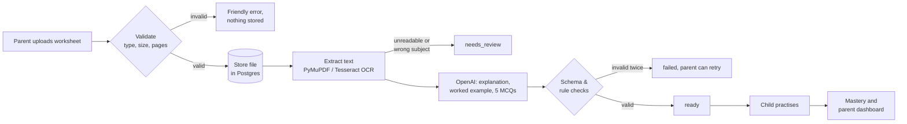

# SmartStudy AI

[](https://github.com/gittoj/SmartStudyAI/actions/workflows/ci.yml)

SmartStudy AI is a learning companion for Singapore Primary 2 to Primary 4 children. A parent photographs or uploads a Mathematics or English worksheet. The app turns it into a short explanation written for the child's level, a worked example and five new practice questions. The child practises on their own profile and gets feedback straight away, and the parent sees which topics need more work.

The full product rules (messages, limits and edge cases) are in [spec.md](spec.md).

---

## Contents

- [Features](#features)
- [How it works](#how-it-works)
- [Tech stack](#tech-stack)
- [Project structure](#project-structure)
- [Local development](#local-development)
- [Configuration](#configuration)
- [Testing and CI](#testing-and-ci)
- [API overview](#api-overview)
- [Deployment (free tier)](#deployment-free-tier)
- [Operations](#operations)
- [Security and privacy](#security-and-privacy)
- [Scope](#scope)

---

## Features

**For parents**
- One parent account, with one to four child profiles. Each profile has a username, a level (P2, P3 or P4) and a 4-digit PIN. Children have no email address or password.
- Worksheet upload (PDF, JPG, PNG or WEBP, up to 10 MB and 10 pages) with a live processing status.
- A dashboard per child. Topics are grouped by subject and mastery level (`needs_practice`, `developing`, `confident`, `not_started`), and the newest worksheets are listed.
- A "Questions to check" list. When a child flags a question as odd, the parent decides whether to hide it or count it.

**For children**
- The child picks their own profile and enters their PIN. Five wrong tries lock the profile for 15 minutes, enforced by the server.
- An explanation written for the child's level, plus one worked example.
- Five multiple-choice questions, shown one at a time, with feedback straight after each answer. The feedback never says "wrong", and there are no scores or comparisons with other children.
- Big buttons and calm colours. The layout works on phones, tablets and desktops, in light or dark mode.

**Accuracy safeguards**
- Questions are generated from the uploaded worksheet text, and new numbers or passages are used instead of copying.
- Every AI reply is checked against a strict schema: exactly four distinct choices, the answer among the choices, and no reuse of the worked example. An invalid reply is asked for once more with the reason it was rejected. If it is invalid again, the worksheet fails visibly and no partial set is shown.
- Pages the OCR can't read clearly, or a worksheet uploaded under the wrong subject, are marked `needs_review` instead of being guessed at.

## How it works



Practice feedback comes from the saved answer key, so submitting an answer never calls OpenAI. The dashboard and practice screens also read only from saved records.

A topic's mastery is based on the latest 10 attempts in that topic (or all of them if there are fewer than 10). Below 50% correct is `needs_practice`. At least 80% correct over at least 5 attempts is `confident`. Anything in between is `developing`.

Two background tasks run while the server is up:
- At startup and then every 5 minutes, any worksheet stuck in processing for 15 minutes is marked as failed (for example after a server restart).
- Every hour, files of `failed` and `needs_review` worksheets older than 7 days are deleted. Rate-limit records older than a day are cleared separately.

## Tech stack

| Layer | Technology |
|---|---|
| Frontend | Next.js 16 (App Router), React 19, TypeScript (strict), Vercel Web Analytics |
| Backend | Python 3.13, FastAPI, Pydantic v2, SQLAlchemy 2 (async) with asyncpg |
| Database | PostgreSQL, migrations with Alembic. Worksheet files are stored in the `stored_files` table. |
| AI | OpenAI API (default model `gpt-4o-mini`) |
| Documents | PyMuPDF for PDF text, Tesseract OCR for photos and scanned pages |
| Auth | Argon2 password and PIN hashes, signed httpOnly session cookies (itsdangerous) |
| Tooling | uv (Python), npm, GitHub Actions, Docker |

## Project structure

```
SmartStudyAI/
├── backend/
│   ├── app/
│   │   ├── api/            # FastAPI routes: auth, children, worksheets, practice, dashboard
│   │   ├── core/           # settings, database engine, security, auth dependencies
│   │   ├── models/         # SQLAlchemy models
│   │   ├── schemas/        # Pydantic request/response models
│   │   ├── services/       # business logic
│   │   │   ├── worksheet_service.py    # upload validation + processing pipeline
│   │   │   ├── document_service.py     # PDF text extraction and OCR
│   │   │   ├── ai_service.py           # OpenAI calls + response validation
│   │   │   ├── exercise_service.py     # answering and grading
│   │   │   ├── analytics_service.py    # mastery and dashboard data
│   │   │   ├── report_service.py       # "this question looks odd" reports
│   │   │   ├── rate_limit_service.py   # login / sign-up throttling
│   │   │   └── storage_service.py      # worksheet file storage (Postgres)
│   │   └── main.py         # app entry point, middleware, background tasks
│   ├── alembic/            # database migrations
│   ├── tests/              # pytest suite (SQLite in memory, OpenAI mocked)
│   ├── Dockerfile          # production image with Tesseract
│   └── .env.example
├── frontend/
│   ├── app/                # pages: / (login), dashboard, students, worksheets, learning, progress
│   ├── components/         # UI components (forms, practice, dashboard, header)
│   ├── lib/                # API client and shared types
│   ├── proxy.ts            # production proxy: /api/* -> backend
│   └── .env.local.example
├── .github/workflows/ci.yml
└── spec.md                 # product specification
```

## Local development

### Prerequisites

- **Node.js** 20.9 or newer
- **[uv](https://docs.astral.sh/uv/)**, which installs the right Python version for you
- **PostgreSQL** 14 or newer
- **[Tesseract OCR](https://github.com/tesseract-ocr/tesseract)**. On Windows, use the [UB Mannheim installer](https://github.com/UB-Mannheim/tesseract/wiki), then either add it to your PATH or set `TESSERACT_CMD` in `backend/.env`.
- An **OpenAI API key**

### 1. Database

Create an empty database and a user for it, for example:

```sql
CREATE USER smartstudy WITH PASSWORD 'choose-a-password';
CREATE DATABASE smartstudy OWNER smartstudy;
```

### 2. Backend

```bash
cd backend
cp .env.example .env        # then fill in DATABASE_URL, SESSION_SECRET and OPENAI_API_KEY
uv sync
uv run alembic upgrade head
uv run uvicorn app.main:app --reload --host 127.0.0.1 --port 8000
```

To create a `SESSION_SECRET`, run:

```bash
uv run python -c "import secrets; print(secrets.token_urlsafe(48))"
```

To check that the backend is running, open <http://localhost:8000/health>. The interactive API docs are at <http://localhost:8000/docs>.

### 3. Frontend

In a second terminal:

```bash
cd frontend
cp .env.local.example .env.local
npm install
npm run dev
```

Then open <http://localhost:3000>. Use `localhost` (not `127.0.0.1`) for both the frontend and the backend, otherwise the login cookies won't be sent.

> **Windows PowerShell:** if `npm` is blocked by the script execution policy, use `npm.cmd`, for example `npm.cmd run dev`.

## Configuration

Settings are read from environment variables. Locally they come from `backend/.env` and `frontend/.env.local`, and in production from the hosting dashboards. **Never commit these files.**

### Backend (`backend/.env`)

| Variable | Required | Default | Purpose |
|---|---|---|---|
| `DATABASE_URL` | yes | n/a | Postgres URL. Neon-style `postgresql://…?sslmode=require` URLs are converted automatically. |
| `SESSION_SECRET` | yes | n/a | Signs session cookies. Use a different long random value in each environment. |
| `OPENAI_API_KEY` | yes | n/a | OpenAI key, used only by the backend |
| `OPENAI_MODEL` | no | `gpt-4o-mini` | Model used for generation |
| `OCR_PROVIDER` | no | `tesseract` | `tesseract` (free, printed text) or `google_vision` (also reads handwriting) |
| `TESSERACT_CMD` | no | empty | Full path to `tesseract.exe` if it isn't on PATH |
| `GOOGLE_VISION_API_KEY` | no | empty | Needed only when `OCR_PROVIDER=google_vision` |
| `GOOGLE_VISION_MONTHLY_LIMIT` | no | `900` | After this many pages a month, falls back to Tesseract |
| `CORS_ORIGINS` | no | `http://localhost:3000` | Comma-separated list of browser origins |
| `COOKIE_SECURE` | no | `true` | Set to `false` only for local HTTP development |
| `PROXY_SHARED_SECRET` | prod | empty | When set, the backend serves only requests that come through the frontend proxy |
| `TRUST_PROXY_HEADER` | prod | empty | Header that carries the visitor's IP (`x-client-ip` in production) |

### Frontend (`frontend/.env.local`)

| Variable | Local | Production (Vercel) |
|---|---|---|
| `NEXT_PUBLIC_API_URL` | `http://localhost:8000` | `/` |
| `BACKEND_URL` | not set | `https://<service>.onrender.com` (server-only) |
| `PROXY_SHARED_SECRET` | not set | same value as the backend (server-only) |

`NEXT_PUBLIC_API_URL` is built into the frontend at build time, so redeploy after changing it.

## Testing and CI

```bash
# Backend
cd backend
uv run pytest -v
uv run pytest --cov=app          # with coverage
uv run python -m compileall app  # syntax check

# Frontend
cd frontend
npm run lint
npx tsc --noEmit
npm run build
```

The backend tests use SQLite in memory and a mocked OpenAI client, so they need no database, API key or network.

[GitHub Actions](.github/workflows/ci.yml) runs on every push to `main` and on every pull request. It has three jobs: backend tests, frontend lint, type check and build, and a Docker image build with a smoke test. No repository secrets are needed.

## API overview

All routes are under `/api`. When the backend is running, the full request and response schemas are at `/docs`.

| Area | Routes | Session |
|---|---|---|
| Auth | `POST /auth/register`, `POST /auth/login`, `POST /auth/logout`, `GET /auth/me` | parent |
| Children | `GET/POST /children`, `DELETE /children/{id}`, `GET /children/choices/list`, `POST /children/{id}/select` (PIN), `POST /children/session/logout` | parent / child |
| Worksheets | `POST /worksheets` (upload), `GET /worksheets/{id}`, `POST /worksheets/{id}/retry`, `DELETE /worksheets/{id}` | parent |
| Practice | `GET /practice/me`, `GET /practice/worksheets`, `GET /practice/worksheets/{id}`, `POST /practice/questions/{id}/answer`, `POST /practice/questions/{id}/report` | child |
| Dashboard | `GET /dashboard/{childId}`, `POST /dashboard/{childId}/reports/{reportId}` | parent |
| Health | `GET /health` | none |

## Deployment (free tier)

| Part | Host | Notes |
|---|---|---|
| Frontend | **Vercel** (Hobby) | Root directory `frontend`. Hobby is for non-commercial use only. |
| Backend | **Render** (Free web service, Docker) | Root directory `backend`, region Singapore. It sleeps after 15 minutes idle, and the first request after that takes about a minute. |
| Database | **Neon** (Free) | Region AWS Singapore. The 1 GB limit is shared by data and worksheet files. |

```
Browser ──► Vercel (Next.js) ──/api/* + shared secret──► Render (FastAPI) ──► Neon (Postgres)
```

The browser only talks to the Vercel site. `frontend/proxy.ts` forwards `/api/*` to the backend, adding a shared secret and the visitor's IP. This keeps login cookies first-party, and the backend refuses any request that doesn't come through the proxy (except `/health`).

### 1. Neon
Create a project in **AWS Asia Pacific 1 (Singapore)**. Under **Connect**, turn **Connection pooling off** and copy the direct connection string. You can paste it into Render unchanged.

### 2. Render (backend)
Create a new **Web Service** from this repo with these settings:
- **Language:** Docker
- **Root Directory:** `backend`
- **Region:** Singapore
- **Instance type:** Free
- **Health Check Path:** `/health`

Optionally, set **Auto-Deploy** to *After CI Checks Pass*.

| Variable | Value |
|---|---|
| `DATABASE_URL` | Neon direct connection string |
| `SESSION_SECRET` | a new random value, different from your local one |
| `PROXY_SHARED_SECRET` | another new random value (also goes into Vercel) |
| `OPENAI_API_KEY` | your key. Set a monthly usage limit in the OpenAI dashboard. |
| `OCR_PROVIDER` | `tesseract` |
| `TRUST_PROXY_HEADER` | `x-client-ip` |
| `COOKIE_SECURE` | `true` |

Migrations run automatically each time the container starts (`alembic upgrade head`). Check that `https://<service>.onrender.com/health` returns `{"status":"ok"}`.

### 3. Vercel (frontend)
Import the repo with **Root Directory** set to `frontend`, and set `NEXT_PUBLIC_API_URL=/`, `BACKEND_URL` and `PROXY_SHARED_SECRET` (see [Configuration](#configuration)).

To see page views, open the project's **Analytics** tab, click **Enable**, then redeploy. Analytics records nothing on localhost.

### 4. Smoke test
- Register, log in, add a child, select the child with their PIN, and practise.
- Upload a worksheet, wait for it to show as ready, then check the dashboard.
- Upload a file close to 10 MB.
- Call `https://<service>.onrender.com/api/auth/me` directly. It should return 404.
- Wait at least 15 minutes, then check that the site wakes up and still works.

## Operations

### Removing a parent account
There is no self-service account deletion yet. To remove an account, open the Neon **SQL Editor** for production, or `psql`/pgAdmin locally. First check that the account exists, then delete it inside a transaction:

```sql
SELECT email, created_at FROM parents WHERE email = 'parent@example.com';

BEGIN;
-- Worksheet files are not linked by a foreign key, so delete them first
DELETE FROM stored_files WHERE key IN (
  SELECT w.storage_key FROM worksheets w
  JOIN children c ON c.id = w.child_id
  JOIN parents p ON p.id = c.parent_id
  WHERE p.email = 'parent@example.com' AND w.storage_key IS NOT NULL
);
-- Children, worksheets, questions, attempts, progress and reports cascade
DELETE FROM parents WHERE email = 'parent@example.com';
COMMIT;
```

### Database migrations
```bash
cd backend
uv run alembic revision --autogenerate -m "describe_change"   # review the generated file
uv run alembic upgrade head
```

## Security and privacy

- **No secrets in code.** All keys and credentials come from environment variables. `.env` files are git-ignored, and the OpenAI key never reaches the browser.
- **Parent-level access control.** A parent session can read and change only that parent's own children, worksheets and progress. A child session can only practise.
- **Hashing and sessions.** Passwords and PINs are stored as Argon2 hashes. Sessions are signed httpOnly cookies, `Secure` in production.
- **Rate limits.** Failed logins are limited per email and per IP address, sign-ups per IP address, and PIN tries per profile (with a lockout). Only keyed hashes of IPs and emails are stored, and they're cleared after a day.
- **Upload validation.** The file type is detected from the file's bytes, not trusted from its extension. Size and page limits are checked before any processing.
- **Private files.** Worksheet files are never returned by the API. Files of `failed` and `needs_review` worksheets are deleted after 7 days.
- **Minimal data.** Children are identified only by a username and level. Worksheet text goes to OpenAI and, if enabled, the OCR provider. It is not sent to any analytics or logging service.
- **Analytics.** Vercel Web Analytics records cookieless page views of fixed paths only, such as `/dashboard`. Don't add custom events, and don't put child, worksheet or answer data in URLs.

## Scope

This MVP covers only **Singapore Primary 2 to Primary 4 Mathematics and English**, with multiple-choice practice. Written answers, live tutoring, social features, school portals and native mobile apps are out of scope.
